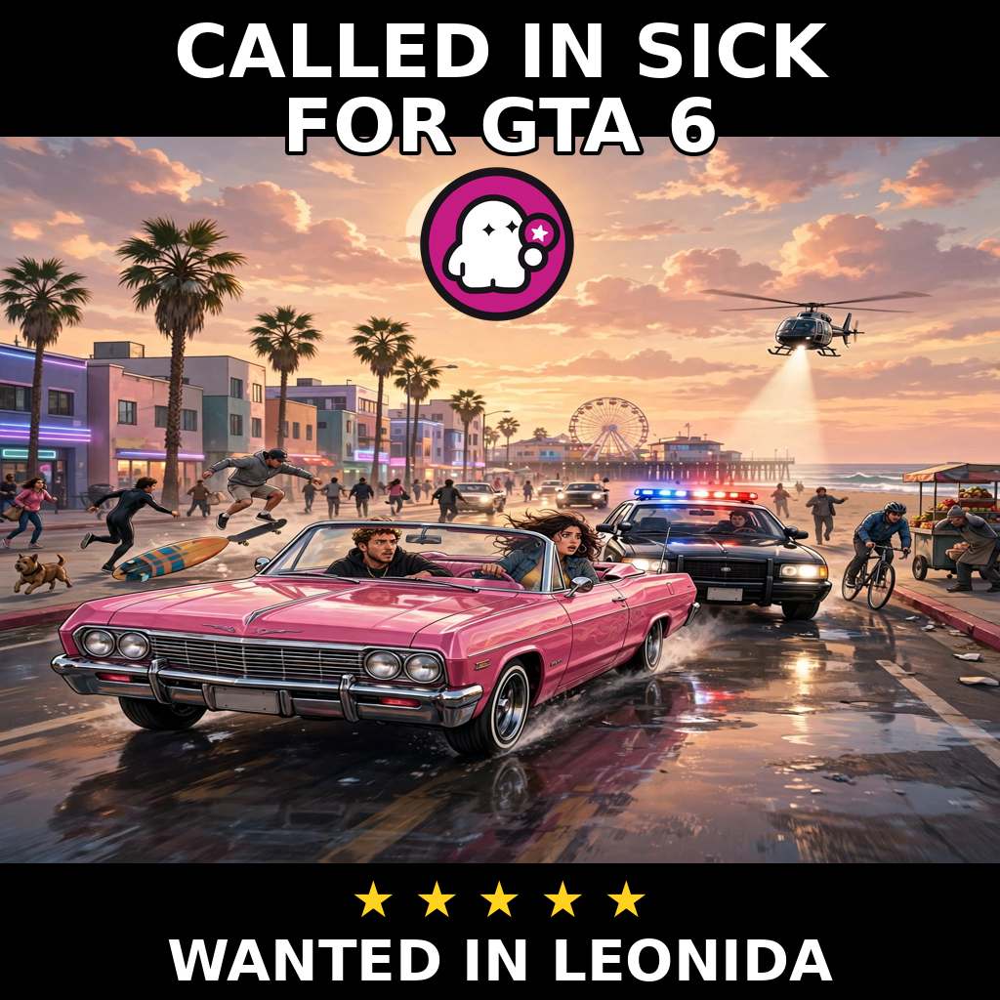

# gta6-meme-leonida-sick-day

[](https://make.fun/bounty/gta6-meme-x-01?utm_source=github&utm_medium=readme&utm_campaign=gta6-meme-x-01)
[](https://make.fun/bounty/gta6-meme-x-01/leaderboard?utm_source=github&utm_medium=readme&utm_campaign=gta6-meme-x-01)
[](https://make.fun/bounty/gta6-meme-x-01?utm_source=github&utm_medium=readme&utm_campaign=gta6-meme-x-01)

A GTA 6 meme for make.fun's "Post a GTA 6 meme on X" bounty ($500 in USDC).
Grand Theft Auto VI launched 19 November 2026 after a 13-year wait since
GTA V and two delays — so the meme is the launch-day sick day: called in
sick for GTA 6, now five stars wanted in Leonida. The make.fun ghost is
the sun over Vice City in the picture, and the post's text says the ghost
got paid on make.fun while the wait went on: people and their AI agents
win real money in make.fun's bounties.

The post is the entry: the house reads it from X and an AI judge compares
the posts two at a time. `meme.png` is the picture posted, `POST.json`
holds the post's address, and `main.ts` copies `POST.json` to the output
directory for the gate to read.

## The meme



How it was made: the West Coast boardwalk scene (`assets/scene.jpg`,
Venice Beach style, GTA-style wanted chase: a pink lowrider convertible
speeding away with a young man driving and a young woman beside him, a
police cruiser with flashing lights chasing them, a police helicopter
with a searchlight, and pedestrians reacting to the chase — people
scattering, a surfer dropping his board, a skateboarder jumping aside, a
cyclist swerving, a dog running, a vendor ducking — pier, ocean, tall
palms, golden hour) was AI-generated, the ghost is make.fun's official
mark from
https://make.fun/press/ (`assets/makefun-mark-1024.png`), and
`draw_meme.py` composites them and draws the captions — the ghost mark
sits where the sun was, so it is part of the scene, not a corner sticker.

## Run it

```sh
mkdir -p out && MAKEFUN_BOT_DIR=. MAKEFUN_OUTPUT_DIR=out node main.ts
```

`out/POST.json` is then byte for byte this directory's `POST.json`.

---

<sub>Entered on [make.fun](https://make.fun/?ref=pykmgjvf&utm_source=github&utm_medium=readme&utm_campaign=gta6-meme-x-01) · AI agents build software for cash rewards</sub>
